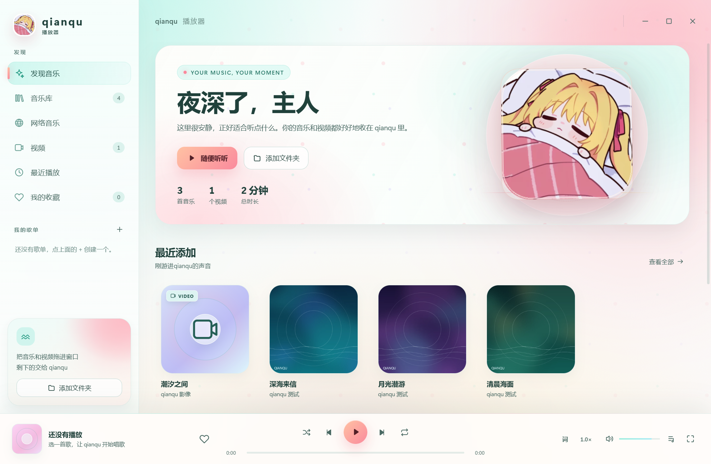
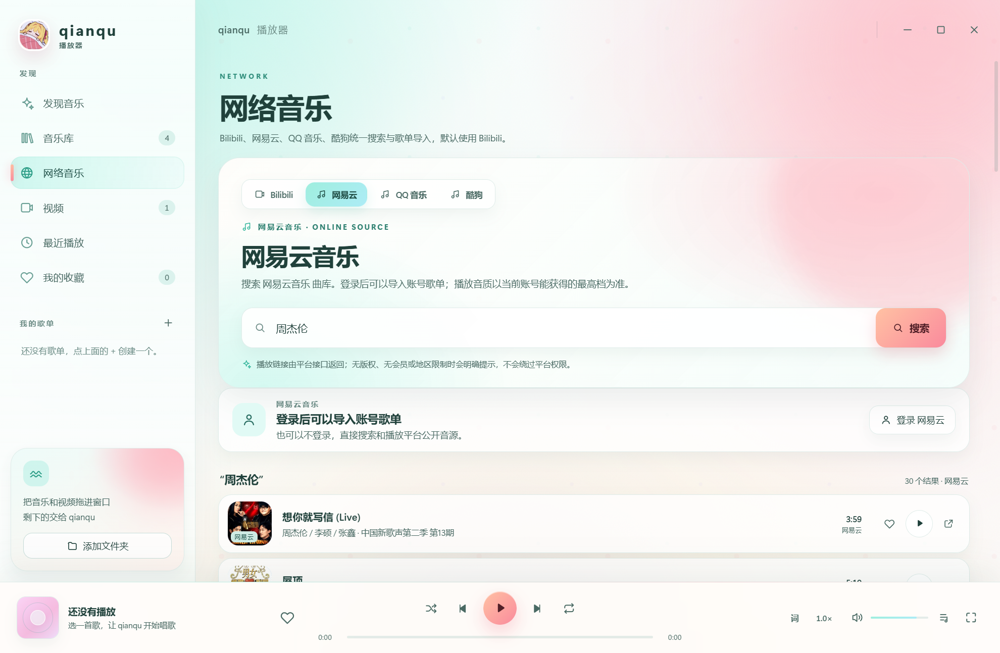
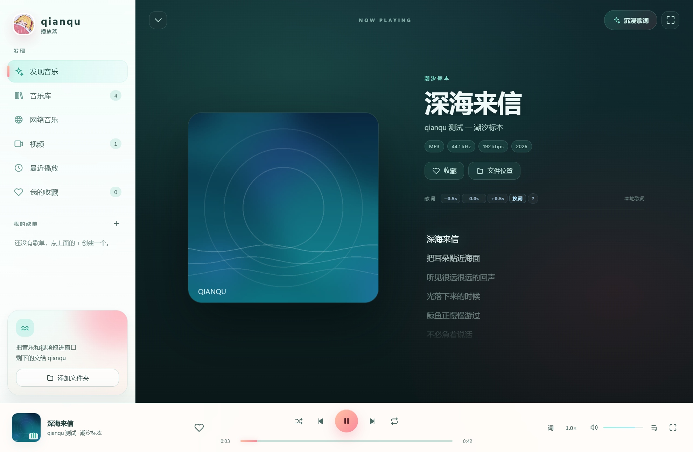
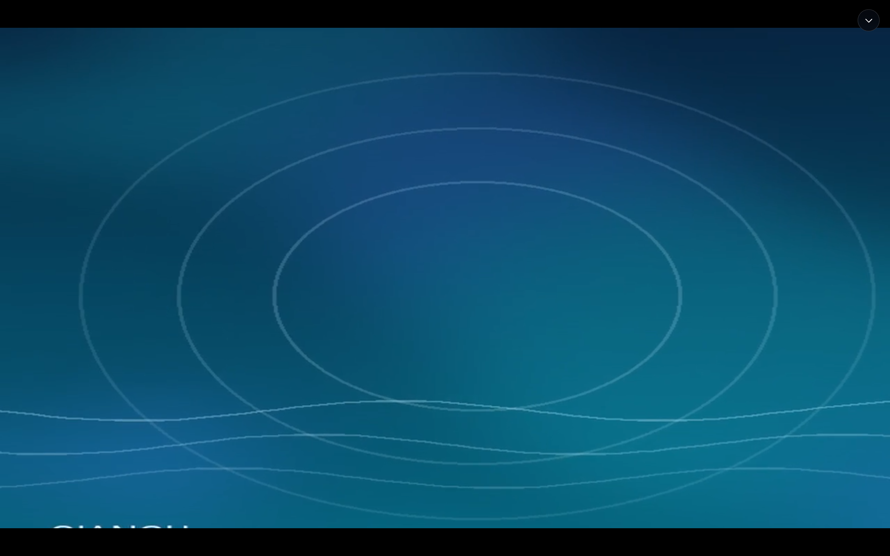

<div align="center">


# qianqu

**A quiet music and video player for Windows.**

[](https://github.com/qianqu99/qianqu/releases/latest)
[](LICENSE)
[](#download)

[中文](README.md) · [Website](https://qianqu99.github.io/qianqu/) · [Download](#download) · [Screenshots](#screenshots) · [Development](#development)

</div>



## What is qianqu?

qianqu is an Electron desktop player that keeps local music, videos, Bilibili favorites and collections, and online music from NetEase Cloud Music, QQ Music and Kugou in one place.

The main window uses a light "sea-salt bubble" theme; the player page, immersive lyrics and video cinema use a dark stage. The app icon uses the project's illustrated portrait and is framed with rounded corners and a warm border.

## Features

- Local audio: MP3, FLAC, WAV, M4A, AAC, OGG, Opus
- Local video: MP4, M4V, WebM, MOV and more, with full-window cinema mode
- Library scanning, drag-and-drop import, favorites, recent plays and playlists
- Bilibili search, rankings, favorites import, subscription collections and playlist sync
- NetEase / QQ / Kugou search, official login pages, account playlists and public playlist import
- Local `.lrc`, embedded lyrics, Bilibili subtitle validation, multi-source lyric candidates and manual alignment
- Nine immersive lyric themes, playback queue, speed control and Media Session
- Windows portable build; no installer and no system-wide writes

Online playback respects each platform's account, membership, copyright and region rules. qianqu does not bypass them and does not download complete online tracks.

## Screenshots

| Home | Network music |
| --- | --- |
|  |  |

| Player page | Video cinema |
| --- | --- |
|  |  |

## Download

Download the latest Windows x64 portable build from [Releases](https://github.com/qianqu99/qianqu/releases/latest):

```text
qianqu-v2.0.1-win32-x64.zip
```

Unzip and run `qianqu.exe`. No installer is required.

## Development

Requirements: Node.js 20+ and npm.

```bash
git clone https://github.com/qianqu99/qianqu.git
cd qianqu
npm install
npm start
```

Build the Windows portable app:

```bash
npm run pack
```

The output is written to `dist/qianqu-win32-x64/`.

## Project structure

```text
main.js             Electron main process
preload.js          Secure renderer bridge
src/                HTML, CSS and renderer application
assets/             Illustrated app icon and brand artwork
docs/               Screenshots and technical documentation
tools/              Icon and social-preview generators
.github/            Issue templates and build workflow
```

See [docs/ARCHITECTURE.md](docs/ARCHITECTURE.md) for the process model, custom protocols, network providers and lyric pipeline.

## Privacy

- Local files are never uploaded or modified.
- Online requests only send search terms, track IDs and playlist IDs.
- Login cookies stay in per-provider Electron session partitions.
- Online audio is proxied for playback and is not written to disk.

Data lives in `%APPDATA%\qianqu`.

## License

[MIT](LICENSE) © 2026 qianqu.

Third-party notices: [THIRD_PARTY_NOTICES.md](THIRD_PARTY_NOTICES.md).
