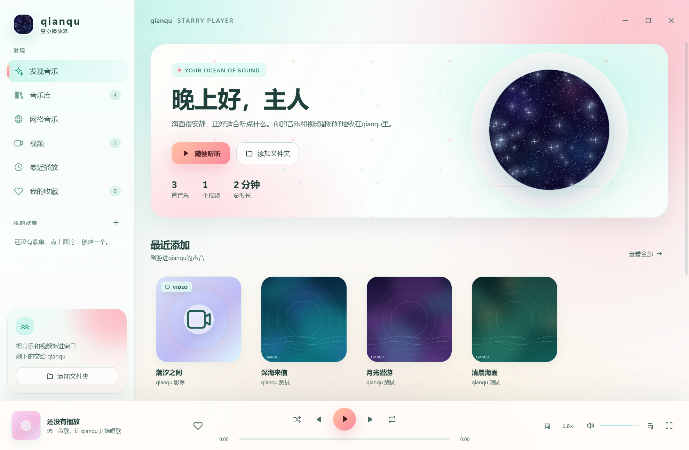
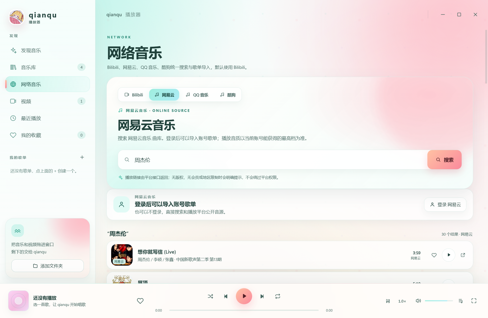
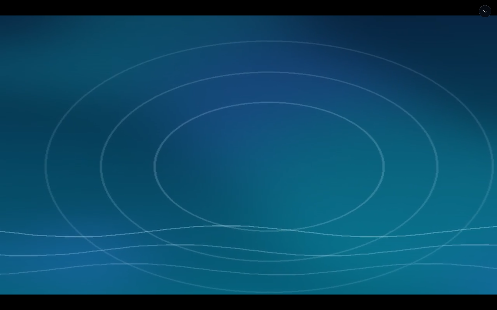

<div align="center">


# qianqu · 星空播放器

**一片闪烁的星空，一个安静好用的本地 / 在线音乐与视频播放器。**

[](https://github.com/qianqu99/qianqu/releases/latest)
[](LICENSE)
[](#下载)
[](https://www.electronjs.org/)
[](https://github.com/qianqu99/qianqu/actions/workflows/build.yml)
[](https://github.com/qianqu99/qianqu/stargazers)

[在线主页](https://qianqu99.github.io/qianqu/) · [下载](#下载) · [功能](#功能) · [截图](#截图) · [网络音乐](#网络音乐) · [歌词](#歌词) · [开发](#开发) · [常见问题](#常见问题) · [贡献](#贡献)

</div>



## 这是什么

**qianqu** 是一个基于 Electron 的 Windows 桌面播放器，把本地音乐、视频、B 站收藏夹与订阅合集、网易云 / QQ 音乐 / 酷狗搜索和歌单放进同一个界面。

主界面是浅色「海盐气泡」主题，播放页、沉浸歌词和视频影院使用深色舞台。应用图标、侧栏标志、启动画面和首页主视觉统一为一片**纯星野**。

- 不依赖云端音乐库，不修改你的本地文件
- 网络音乐只在你主动搜索、打开榜单或导入歌单时访问平台接口
- 在线曲目只保存标题、歌手、封面、平台 ID 等信息，不下载完整音频
- 登录使用各平台官方页面，Cookie 保存在独立会话分区
- 所有界面、逻辑和图标都在本仓库中，可直接运行、修改和打包

> 当前发布版本：**v2.0.0** · Windows 10 / 11 x64 · 绿色免安装

## 功能

| 模块 | 能力 |
| --- | --- |
| 本地音乐 | MP3 / FLAC / WAV / M4A / AAC / OGG / Opus，读取标题、艺术家、专辑、年份、时长和内嵌封面 |
| 本地视频 | MP4 / M4V / WebM / MOV 等，播放页全屏影院，视频铺满窗口 |
| 音乐库 | 扫描文件夹、拖拽导入、音乐库 / 视频 / 最近播放 / 我的收藏 |
| 歌单 | 新建、重命名、删除、右键加歌、播放全部、随机播放、列表循环 / 单曲循环 |
| Bilibili | 搜索、热歌榜、新歌速递、收藏夹导入、订阅合集导入、歌单更新 |
| 网易云 / QQ / 酷狗 | 搜索、登录官方页面、账号歌单读取、公开歌单链接导入 |
| 歌词 | 本地 `.lrc`、内嵌歌词、B 站字幕校验、网易云 / QQ 多来源候选、偏移与逐句对齐 |
| 播放体验 | 播放队列、倍速、音量、进度拖动、Media Session、窗口状态记忆 |
| 视觉 | 9 种沉浸歌词主题、星野图标、浅色主界面、深色播放舞台 |
| 数据 | 自动保存音乐库、歌单、收藏、最近播放、在线曲目和窗口状态 |

## 截图

| 首页 | 网络音乐 |
| --- | --- |
|  |  |

| 沉浸歌词 | 视频影院 |
| --- | --- |
|  |  |

## 下载

### 推荐：Windows 绿色版

前往 **[Releases](https://github.com/qianqu99/qianqu/releases/latest)** 下载：

```text
qianqu-v2.0.0-win32-x64.zip
```

解压后双击 `qianqu.exe` 即可运行，不需要安装，也不会写入系统目录。

直接下载：

- [qianqu v2.0.0 · Windows x64](https://github.com/qianqu99/qianqu/releases/download/v2.0.0/qianqu-v2.0.0-win32-x64.zip)
- [SHA256 校验文件](https://github.com/qianqu99/qianqu/releases/download/v2.0.0/SHA256.txt)
- [源代码 zip](https://github.com/qianqu99/qianqu/archive/refs/tags/v2.0.0.zip)

### 系统要求

- Windows 10 / 11 x64
- 约 400 MB 磁盘空间
- 在线音乐需要能访问对应平台；B 站、网易云、QQ 音乐、酷狗的可播放范围以账号权限和平台规则为准

### 首次运行提示

如果 Windows SmartScreen 提示「未知发布者」，点「更多信息」→「仍要运行」。绿色版没有购买代码签名证书，这是正常提示。

## 快速开始

1. 解压 `qianqu-v2.0.0-win32-x64.zip`。
2. 双击 `qianqu.exe`。
3. 点侧栏左下角「添加文件夹」，或把音乐 / 视频直接拖进窗口。
4. 在「网络音乐」里选择 Bilibili、网易云、QQ 音乐或酷狗。
5. 需要账号歌单时点「登录」，在官方页面完成登录后导入。

## 网络音乐

网络音乐页顶部可以切换四个来源，默认 **Bilibili**：

| 来源 | 搜索 | 登录 | 歌单导入 | 音质 / 画质 |
| --- | --- | --- | --- | --- |
| Bilibili | 支持 | 支持 | 收藏夹、订阅合集、歌单更新 | 原视频可用音轨 |
| 网易云音乐 | 支持 | 支持 | 账号歌单、公开歌单链接 | 当前账号可用最高档 |
| QQ 音乐 | 支持 | 支持 | 账号歌单、公开歌单链接 | 当前账号可用最高档 |
| 酷狗音乐 | 支持 | 支持 | 公开歌单链接；账号歌单视接口可用性 | 当前账号可用最高档 |

实现方式：

- 搜索与播放地址通过 [@meting/core](https://www.npmjs.com/package/@meting/core) 访问平台接口。
- 登录窗口打开对应平台的官方页面，qianqu 只保存该平台的 Cookie。
- 各平台 Cookie 使用独立会话分区：`Partitions/bili-auth`、`Partitions/music-netease-auth`、`Partitions/music-qq-auth`、`Partitions/music-kugou-auth`。
- 播放地址通过本地 `qianqu-music://` 协议代理，透传 Cookie、Range 和 CORS 头，不把完整音频写入磁盘。
- 音质请求会向平台申请当前账号可获得的最高档；平台返回无权限、无版权或地区限制时会明确提示，不绕过限制。

> 在线音乐版权归原平台和权利人所有。qianqu 只做个人播放，不提供批量下载、去水印、绕过会员 / 地区限制或再分发功能。

## B 站歌单

- 登录 B 站后，可以把自建收藏夹、收藏的他人收藏夹和订阅合集导入为本地歌单。
- 收藏夹生成 `B站 · 收藏夹名`，合集生成 `B站合集 · 合集名`。
- 合集通过章节接口分页读取，单次最多 500 首。
- 已导入的 B 站歌单可以点「更新 B 站歌单」，补齐新增、移除远端已删除的曲目，并保留手动改过的歌单名和本地附加歌曲。
- 只保存 BVID、CID、标题、UP 主、封面、时长等曲目信息；播放时再解析音频流。

## 歌词

qianqu 的歌词不是简单按总时长拉伸，而是按来源和版本做匹配：

- 本地歌曲优先读取同目录同名 `.lrc`，支持 UTF-8 / GBK，也支持音频内嵌歌词。
- B 站曲目优先匹配公开云歌词；B 站字幕必须通过时长覆盖、字幕密度和口播词校验，才会作为备用时间轴。
- 网易云 / QQ 在线曲目读取平台歌词；没有匹配时显示未匹配，不会拿别的歌硬套。
- 播放页支持 `−0.5s / +0.5s` 偏移，快捷键 `[` / `]` 移动 0.5 秒，`{` / `}` 移动 0.1 秒，`\` 归零。
- 双击任意歌词行，可以把该句对齐到当前播放时间，偏移按曲目保存。
- 「换词」可以同时搜索网易云和 QQ 的歌词候选，并标记 Live / 伴奏 / Cover / DJ 等版本差异。

自动匹配不可能保证每一首 100% 准确，尤其是翻唱、AI 重编曲、加速 / 减速和剪辑版本；qianqu 提供了逐句对齐和手动偏移来兜底。

## 快捷键

| 快捷键 | 功能 |
| --- | --- |
| `Space` | 播放 / 暂停 |
| `Ctrl + O` | 添加文件 |
| `Ctrl + Shift + O` | 添加文件夹 |
| `Ctrl + M` | 最小化窗口 |
| `F11` | 进入 / 退出窗口全屏 |
| `← / →` | 后退 / 前进 5 秒 |
| `↑ / ↓` | 音量加减 |
| `M` | 静音 |
| `F` | 收藏当前曲目 |
| `Q` | 打开 / 关闭播放队列 |
| `L` | 打开 / 关闭沉浸歌词 |
| `T` | 切换歌词主题 |
| `[` / `]` | 歌词提前 / 延后 0.5 秒 |
| `{` / `}` | 歌词提前 / 延后 0.1 秒 |
| `\` | 歌词偏移归零 |
| `N / P` | 下一首 / 上一首 |
| `Esc` | 退出视频影院、关闭弹窗 / 菜单 / 播放页 |
| 双击歌词行 | 把该句对齐到当前播放时间 |
| 双击视频 | 进入 / 退出视频影院 |

## 技术栈

- **Electron 45**：主进程、窗口、协议代理、会话与 IPC
- **原生 HTML / CSS / JavaScript**：没有前端框架，方便直接改界面
- **Canvas**：沉浸歌词的星野、频谱和动效
- **music-metadata**：本地音频元数据与内嵌封面
- **@meting/core**：网易云 / QQ / 酷狗搜索、播放地址、歌单和歌词
- **iconv-lite**：GBK 等本地歌词编码
- **@electron/packager**：Windows 绿色版打包

## 项目结构

```text
qianqu/
├─ main.js                     Electron 主进程：窗口、媒体库、网络源、歌词、存档
├─ preload.js                  渲染进程安全桥接
├─ src/
│  ├─ index.html               页面结构、SVG 图标
│  ├─ styles.css               基础视觉、布局、播放页、歌词舞台
│  ├─ theme-fresh.css          浅色「海盐气泡」主题覆盖
│  └─ app.js                   播放器、视图、歌单、队列、歌词逻辑
├─ assets/
│  ├─ icon.png                 1024px 星空图标
│  ├─ icon-512.png             512px 星空图标
│  ├─ icon.ico                 Windows 多尺寸图标
│  └─ brand-mark.png           侧栏 / 启动页 / 首页品牌图
├─ docs/
│  ├─ screenshots/             README 截图
│  ├─ ARCHITECTURE.md          进程、协议、数据流说明
│  ├─ FAQ.md                   常见问题
│  ├─ release-notes-v2.0.0.md  发布说明
│  ├─ index.html               GitHub Pages 主页
│  ├─ site.css                 Pages 主页样式
│  └─ social-preview.png       GitHub 社交预览图
├─ tools/
│  ├─ make-starry-icon.py      生成星空图标
│  └─ make-social-preview.py   生成社交预览图
├─ .github/                    Issue / PR 模板、Dependabot、构建工作流
├─ 使用说明.txt                给最终用户的快速说明
├─ CONTRIBUTING.md             贡献指南
├─ CHANGELOG.md                版本记录
├─ SECURITY.md                 安全说明
├─ THIRD_PARTY_NOTICES.md      第三方依赖与许可
├─ LICENSE                     MIT
└─ README.md
```

更详细的数据流和协议说明见 [docs/ARCHITECTURE.md](docs/ARCHITECTURE.md)。

## 开发

需要 Node.js 20+ 和 npm。命令使用 bash / Git Bash / WSL 写法：

```bash
git clone https://github.com/qianqu99/qianqu.git
cd qianqu
npm install
npm start
```

如果 Electron 下载缓慢：

```bash
export ELECTRON_MIRROR='https://npmmirror.com/mirrors/electron/'
npm install
```

语法检查：

```bash
npm run lint
```

### 打包 Windows 绿色版

```bash
npm run pack
```

产物位于 `dist-v200/qianqu-win32-x64/`，双击 `qianqu.exe` 运行。

### 目录约定

- `work/` 只放开发测试素材，已在 `.gitignore` 中排除，不会进入源码包或安装包。
- `dist-*/` 是打包输出，不提交到仓库。
- 修改界面时优先改 `src/`；修改主进程、网络源或协议时改 `main.js`。
- 发布前至少跑一次 `npm run lint` 和 `npm run pack`，并用打包后的 exe 做一次启动 / 播放 / 网络搜索检查。

## 数据与隐私

音乐库、歌单、收藏、在线曲目和设置保存在：

```text
%APPDATA%\qianqu\library.json
```

封面缓存在 `%APPDATA%\qianqu\covers`，B 站歌词缓存在 `%APPDATA%\qianqu\bili-lyrics-cache.json`。

各平台登录 Cookie 保存在：

```text
%APPDATA%\qianqu\Partitions\bili-auth
%APPDATA%\qianqu\Partitions\music-netease-auth
%APPDATA%\qianqu\Partitions\music-qq-auth
%APPDATA%\qianqu\Partitions\music-kugou-auth
```

- 本地播放不上传、不修改音乐文件。
- 网络音乐只发送搜索词、曲目 ID、歌单 ID 等必要参数，不上传本地文件或音频。
- 退出登录会清除对应平台的 Cookie，不会影响浏览器里的账号，也不会删除已导入的歌单。
- 删除 `%APPDATA%\qianqu` 会重置播放器记录和登录状态，不会删除音乐 / 视频文件。

## 常见问题

### 为什么在线歌曲提示没有播放权限？

平台对版权、会员、地区和账号状态有限制。qianqu 会按当前账号能获得的最高音质请求播放地址；平台不返回地址时会明确提示，不会绕过限制。可以登录对应平台账号，或换一首有权限的版本。

### 为什么 QQ / 酷狗登录后有些歌单读不到？

账号歌单接口由平台控制，可能随版本、地区或账号状态变化。读不到账号歌单时，可以在导入弹窗里粘贴公开歌单链接或 ID。

### 为什么歌词会慢半拍？

翻唱、AI 重编曲、加速 / 减速、剪辑版本的时间轴和原版不同。用播放页的 `−0.5s / +0.5s` 或快捷键微调；也可以双击歌词行，把该句对齐到当前时间。偏移按曲目保存。

### 为什么视频上下有黑边？

视频影院会铺满窗口并保持原始画面比例，屏幕比例和视频比例不一致时会出现黑边。这是为了避免拉伸变形。

### 会下载在线音频吗？

不会。在线播放只解析临时播放地址，通过本地代理交给播放器，不把完整音频写入磁盘。

### 支持 macOS / Linux 吗？

当前只发布 Windows x64 绿色版。项目是 Electron 应用，理论上可以移植，但窗口控制、协议和打包脚本需要针对平台调整；欢迎提交 PR。

更多问题见 [docs/FAQ.md](docs/FAQ.md)。

## 贡献

欢迎提交 Issue 和 PR：

- 提交 Bug 前先搜索现有 Issue，附上版本、系统、复现步骤和相关日志。
- 代码改动请保持现有结构，不要引入大型前端框架。
- 提交前运行 `npm run lint`；涉及播放、网络或打包的改动请说明验证方式。
- 不要提交 `node_modules/`、`dist-*/`、`work/` 或任何账号 Cookie / Token。

详细流程见 [CONTRIBUTING.md](CONTRIBUTING.md)。

## 版本记录

当前版本 **v2.0.0**：星空图标、qianqu 更名、四平台网络音乐、视频全屏影院、右上角按钮悬停修复、移除旧工具栏和 Apple 试听。

完整记录见 [CHANGELOG.md](CHANGELOG.md) 和 [v2.0.0 发布说明](docs/release-notes-v2.0.0.md)。

## 许可

[MIT](LICENSE) © 2026 qianqu

第三方依赖及许可见 [THIRD_PARTY_NOTICES.md](THIRD_PARTY_NOTICES.md)。

## 致谢

- 全屏歌词舞台的交互方向参考 [Folia](https://github.com/chthollyphile/folia-major)（AGPL-3.0）。qianqu 没有复制其源代码，而是用本项目自己的 HTML / CSS / Canvas 逻辑实现。
- Bilibili 音乐源的功能方向参考 [BiliMusic](https://github.com/HanversionOvO/BiliMusic)；搜索、榜单、音频流解析和界面均按本项目的 Electron / 原生 JavaScript 结构独立实现。
- 歌词候选清洗、多来源搜索与手动换词思路参考 BiliMusic 与 [Lyricify Lyrics Helper](https://github.com/WXRIW/Lyricify-Lyrics-Helper)（Apache-2.0）。
- 在线音乐搜索与播放地址解析使用 [@meting/core](https://github.com/metowolf/Meting)（MIT）。
- 本地音频元数据使用 [music-metadata](https://github.com/Borewit/music-metadata)（MIT）。
- 界面整理参考 [Refactoring UI](https://www.refactoringui.com/) 与 [refactoring-ui-skill](https://github.com/edisonmbli/refactoring-ui-skill)。

---

<div align="center">

**如果 qianqu 让你安静听完了某一首歌，欢迎点一个 Star。**

[在线主页](https://qianqu99.github.io/qianqu/) · [GitHub](https://github.com/qianqu99/qianqu) · [Releases](https://github.com/qianqu99/qianqu/releases) · [Issues](https://github.com/qianqu99/qianqu/issues)

</div>
